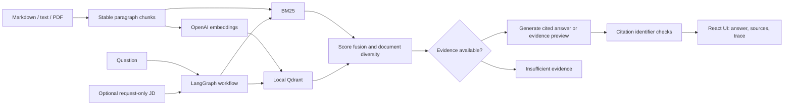

# CareerLens

An evidence assistant for job hunting: ask questions about documented experience, inspect the retrieved passages, and compare that evidence with a job description supplied for the current request.

I built CareerLens to practice RAG as an application: ingestion, retrieval, workflow design, provider integration, cost control, and evaluation. The public demo uses **fictional candidate and internship records**. My private resume, internship evidence, original evaluation outputs, API keys, and spending records are excluded.

## What it does

- Ingests Markdown, text, and text-based PDFs into stable, traceable paragraph chunks.
- Runs locally with BM25 and an evidence preview, with no API key or paid calls required.
- Adds OpenAI embeddings and a local Qdrant vector store for hybrid retrieval.
- Uses LangGraph to route retrieval, generation or abstention, and citation checks.
- Shows cited answers, source passages, retrieval methods, and workflow steps in a React interface.
- Accepts a pasted JD for one question; the JD is not stored in the evidence index.
- Includes 30 labelled synthetic development cases and separate retrieval/full-pipeline metrics.
- Reserves estimated API costs before calls and accounts for reported token usage afterward.

## Architecture



Retrieval uses normalized score fusion, a score threshold, and document diversification. The graph is a fixed orchestration workflow; it does not autonomously choose tools or search the web for missing personal facts.

## Run locally

Prerequisites: Python 3.11+, Node.js 20.19+ or 22.12+, and pnpm.

From the repository root on Windows:

```powershell
py -m venv .venv
.venv\Scripts\python -m pip install -r requirements.txt
.venv\Scripts\python -m uvicorn app.main:app --reload
```

In another terminal:

```powershell
cd frontend
pnpm install --frozen-lockfile
pnpm dev
```

Open http://localhost:5173. The Vite proxy sends `/api` requests to the backend on port 8000. On macOS/Linux, use `python3 -m venv .venv` and `.venv/bin/python` for the backend commands.

Try: “What did Alex build at Northstar Media?”, “Which projects demonstrate Generative AI work?”, or “Which achievements are documented?” Without a key, the application returns source excerpts rather than an LLM-generated answer.

### Optional model generation

Copy `.env.example` to `.env` and configure `OPENAI_API_KEY` locally. The public default is `gpt-4.1-mini`, with `text-embedding-3-small` for embeddings. The example generation rates are $0.40 input / $1.60 output per million tokens, based on the [official model documentation](https://developers.openai.com/api/docs/models/gpt-4.1-mini). Verify rates when switching models. Leave `OPENAI_REASONING_EFFORT` blank for the default non-reasoning model.

Adding a key enables paid document/query embeddings and answer generation. Personal passages, questions, and a pasted JD are then transmitted to OpenAI. `store=False` disables Responses API application storage; it is not a promise of zero provider retention.

## Evaluation and testing

```powershell
.venv\Scripts\python -m pytest
.venv\Scripts\python -m app.eval_cli
cd frontend
pnpm build
```

The CLI explicitly selects lexical retrieval. Run without an API key for a fully offline check; startup can build embeddings if a key is present. The interface evaluation button selects hybrid retrieval and may incur embedding costs when configured.

See [evals/README.md](evals/README.md) for case categories and metric definitions. This synthetic development set is small and self-authored. Results are not a general performance guarantee. Private benchmark scores have deliberately not been copied into the public demo, because its corpus and labels differ.

The [public lexical baseline](evals/BASELINE.md) measured 0.938 document Recall@5 and 0.861 MRR@5; synthesis recall was 0.500. It includes failures and is not a full LLM evaluation.

## Budget and data boundaries

The default application cap is $4.50. The ledger reserves conservative estimates before each call, then replaces the reservation with reported token costs. Failed calls retain their reservation when billing is uncertain. It covers calls made by this application only and is not an OpenAI account-wide spend limit. Check provider billing controls separately.

Credentials, uploaded documents, vector indexes, generated reports, and the budget ledger are ignored by Git. Included files under `data/sample/` are fictional fixtures. Replacing them or adding personal evidence changes evaluation expectations; review staged files before publishing changes.

This is a local prototype: it has no authentication, multi-user isolation, or upload-size controls. Keep the development server on localhost. Citation checks validate identifiers, not the entailment of each generated claim; full evaluations report this limitation explicitly.

## Development phases

The initial publication is organized into phase commits so reviewers can inspect each subsystem. These commits import the existing milestone on the publication date; they do not recreate historical timestamps.

1. Foundation: configuration, typed contracts, document parsing, and budget ledger.
2. Retrieval: BM25, embeddings, Qdrant, fusion, and fictional demo corpus.
3. Workflow: LangGraph orchestration, generation, abstention, and citation checks.
4. Interface: FastAPI endpoints and React evidence/trace UI.
5. Evaluation: synthetic labelled cases, metrics, and offline tests.
6. Publication: setup guide, architecture, limitations, and reproducible checks.

Next experiments: expand and independently review evaluation labels, assess claim support beyond citation IDs, measure chunking/retrieval tradeoffs, and test provider error paths. Add reranking only if comparative measurements justify it.

## Development workflow

Repository-wide [AI coding rules](AGENTS.md) document evidence boundaries,
focused changes, offline checks and honest
reporting. For behavior changes, write acceptance criteria in a small `specs/`
document before implementation, then connect the criteria to tests and review the
resulting diff.

[Retrieval index consistency](specs/index-consistency.md) documents a failure
boundary with offline regression coverage for stale search results and paginated
index pruning. These checks do not change the published evaluation baseline or
the project's local-prototype status.
